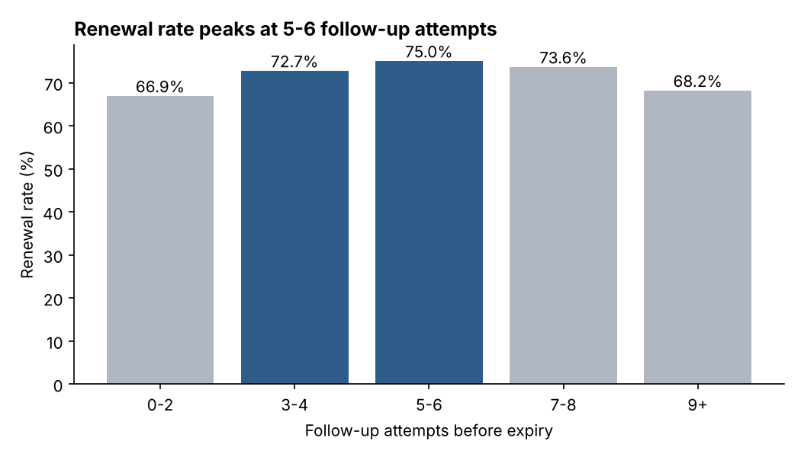
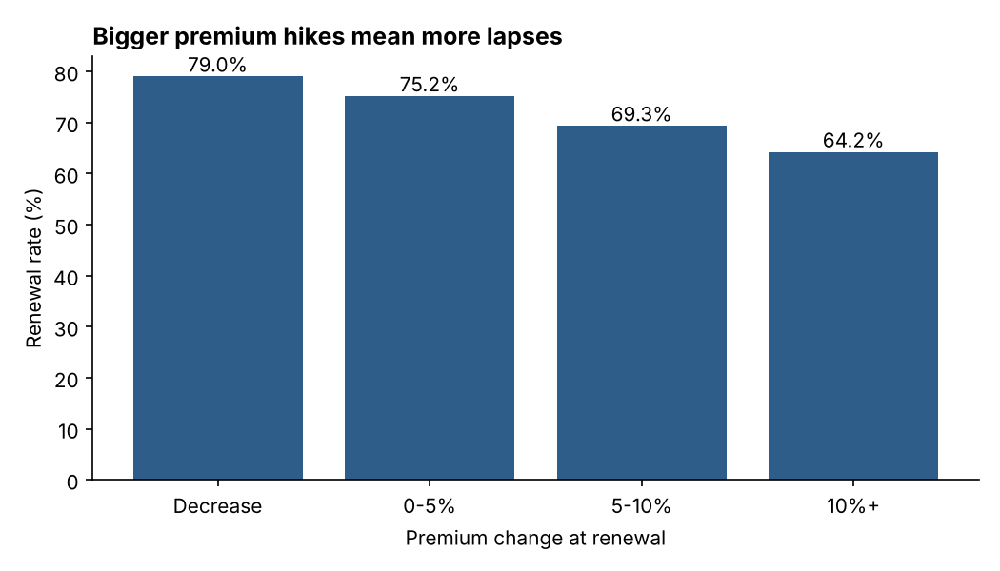
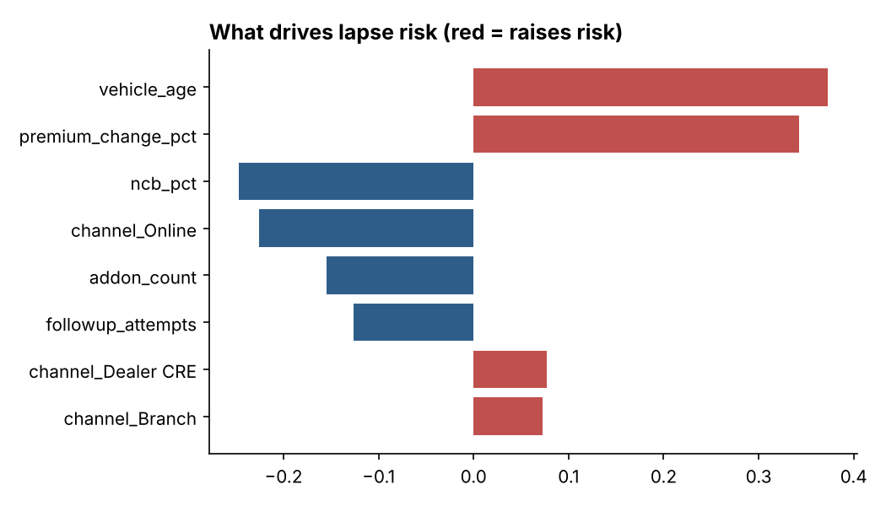
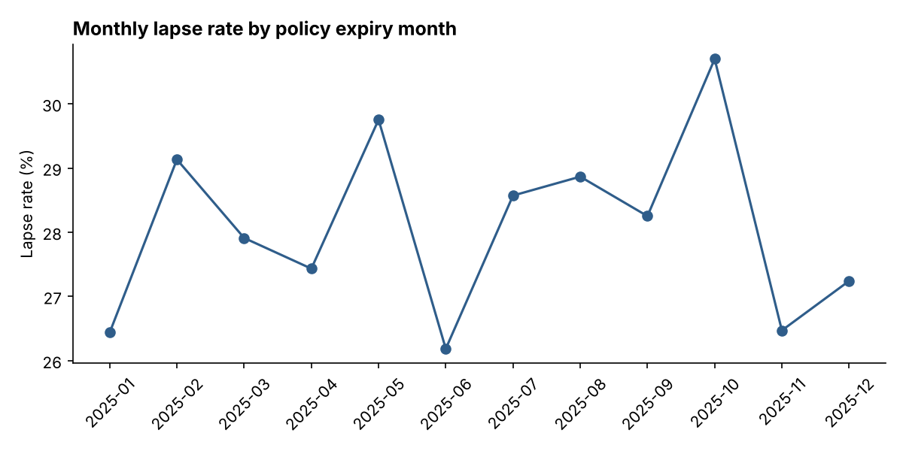

# Motor Insurance Renewal & Lapse Analytics

An end-to-end analytics project that studies **why motor insurance policies lapse instead of renewing**, and which actions bring renewals back. It covers data validation, SQL analysis, Python charts and a lapse-prediction model.

> **Data note:** the dataset is **synthetic**, generated by `src/generate_data.py`. It is modelled on real-world renewal workflows (dealer CREs, follow-up calls, NCB, add-ons), but it contains no real customer, dealer or insurer data.

**Tools:** Python (Pandas, NumPy, Scikit-learn, Matplotlib) · SQL (SQLite: CTEs, window functions, CASE bucketing) · data validation

---

## Business problem

Every month thousands of policies come up for renewal through dealer Customer Relationship Executives (CREs). Each lapsed policy is lost premium. The questions:

1. What is the renewal (retention) rate, and how does it vary by OEM, dealer and month?
2. Do more follow-up calls actually help, and is there a point where they stop working?
3. How sensitive are customers to premium increases?
4. Can we predict which policies are likely to lapse, so CREs call those customers first?

## Dataset

| Table | Rows | Key columns |
|---|---|---|
| `policies.csv` | 20,020 | policy_id, dealer_id, oem, city, vehicle_age, idv, addon_count, ncb_pct, prev_premium, renewal_premium, expiry_date, channel, followup_attempts, renewed |
| `dealers.csv` | 50 | dealer_id, oem, city |

## Project steps

### 1. Data validation (`src/data_validation.py`)
Checks run before any analysis:

| Check | Issues found |
|---|---|
| Duplicate policy rows | 20 |
| Negative or zero premium | 20 |
| Invalid NCB % (not 0/20/25/35/45/50) | 20 |
| Missing values | 0 |

After cleaning: **19,960 policies**.

### 2. SQL analysis (`sql/analysis_queries.sql`, run with `src/run_sql.py`)
Six queries: overall retention, renewal by OEM with premium retained, follow-up attempt bands, monthly lapse cohort, bottom-10 dealers (CTE + `RANK()` window function), and premium-change price sensitivity.

### 3. Charts (`src/analysis.py`)
### 4. Lapse prediction model (`src/lapse_model.py`)
Logistic Regression and Random Forest (with class balancing) predict whether a policy will lapse.

---

## Key findings

**Overall renewal rate: 71.9%** (lapse rate 28.1%).

**1. Follow-ups work, up to a point.** Renewal rises from 66.9% (0–2 attempts) to **75.0% at 5–6 attempts**, then falls at 9+ attempts. Too many calls likely annoy customers.



**2. Customers are price-sensitive.** Renewal drops from 79.0% when the premium decreases to **64.2% when it rises 10%+**, a gap of almost 15 points.



**3. Lapse drivers.** Older vehicles and bigger premium hikes raise lapse risk. Higher NCB, more add-ons, online renewal and more follow-ups lower it.



**4. Dealer gap.** The weakest dealers renew at 66.8–69.5%, against 71.9% overall. These are the first targets for CRE coaching.

**5. Monthly lapse rate** stays between 26% and 31%, with peaks in May and October worth investigating.



### Model results

| Model | Accuracy | ROC-AUC |
|---|---|---|
| Logistic Regression (balanced) | 0.62 | 0.67 |
| Random Forest (balanced) | 0.63 | 0.66 |

The model catches **64% of lapses** (recall). Used as a priority list, **calling the riskiest 30% of policies reaches 46% of all lapses**, so CRE time goes where it matters most. The model is a ranking tool, not a perfect predictor.

## Recommendations

1. Aim for **5–6 follow-up attempts** per policy. Fewer leaves renewals on the table; more stops helping.
2. Flag policies with a **premium increase above 10%** for proactive offers (add-on bundles, NCB reminders).
3. Use the lapse-risk score to **order CRE call lists** each morning.
4. Coach the **bottom-10 dealers** using the top dealers' follow-up patterns.
5. Push **online renewal links**, which show lower lapse risk.

---

## How to run

```bash
pip install -r requirements.txt
python src/generate_data.py     # create synthetic data
python src/data_validation.py   # clean and report data issues
python src/run_sql.py           # run SQL analysis
python src/analysis.py          # build charts
python src/lapse_model.py       # train lapse model
```

## Project structure

```
├── data/               # synthetic CSVs (raw + clean)
├── images/             # charts used in this README
├── sql/                # analysis queries
├── src/
│   ├── generate_data.py
│   ├── data_validation.py
│   ├── run_sql.py
│   ├── analysis.py
│   └── lapse_model.py
└── requirements.txt
```

**Author:** Shafiya Sultana N · [LinkedIn](https://linkedin.com/in/shafiyasultanan)
